

<picture><source media="(prefers-color-scheme: dark)" srcset=".github/assets/readme/hero-dark.svg">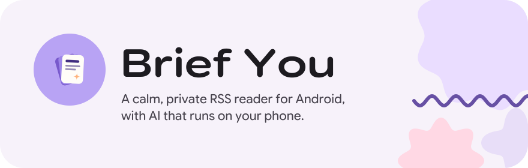</picture>

<a href="../../releases/latest"><picture><source media="(prefers-color-scheme: dark)" srcset=".github/assets/badges/download-dark.svg"></picture></a>
<a href="https://apps.obtainium.imranr.dev/redirect?r=obtainium://add/https://github.com/Humorist2601/BriefYou"><picture><source media="(prefers-color-scheme: dark)" srcset=".github/assets/badges/obtainium-dark.svg"></picture></a>

<picture><source media="(prefers-color-scheme: dark)" srcset=".github/assets/badges/ai-dark.svg"></picture>
<picture><source media="(prefers-color-scheme: dark)" srcset=".github/assets/badges/private-dark.svg"></picture>
<picture><source media="(prefers-color-scheme: dark)" srcset=".github/assets/badges/android-dark.svg"></picture>
<picture><source media="(prefers-color-scheme: dark)" srcset=".github/assets/badges/license-dark.svg"></picture>

<picture><source media="(prefers-color-scheme: dark)" srcset=".github/assets/readme/card-ai-dark.svg"></picture>
<picture><source media="(prefers-color-scheme: dark)" srcset=".github/assets/readme/card-triage-dark.svg">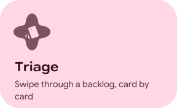</picture>
<picture><source media="(prefers-color-scheme: dark)" srcset=".github/assets/readme/card-listen-dark.svg">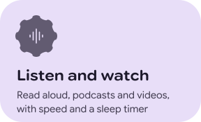</picture>
<picture><source media="(prefers-color-scheme: dark)" srcset=".github/assets/readme/card-calm-dark.svg">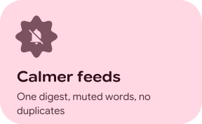</picture>
<picture><source media="(prefers-color-scheme: dark)" srcset=".github/assets/readme/card-stats-dark.svg">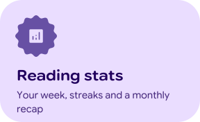</picture>
<picture><source media="(prefers-color-scheme: dark)" srcset=".github/assets/readme/card-backup-dark.svg">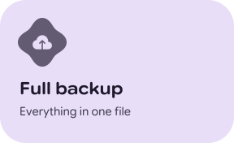</picture>

Brief You is a calm, private RSS reader with AI that runs **entirely on your phone**: articles and questions never leave it. It supports Material You design, Reeder-style reading, FreshRSS, Miniflux, Fever, the Google Reader API and more, and installs as its own app (app ID `com.ay.briefyou`); move your feeds over with OPML.

<picture><source media="(prefers-color-scheme: dark)" srcset=".github/assets/screenshots-dark.png">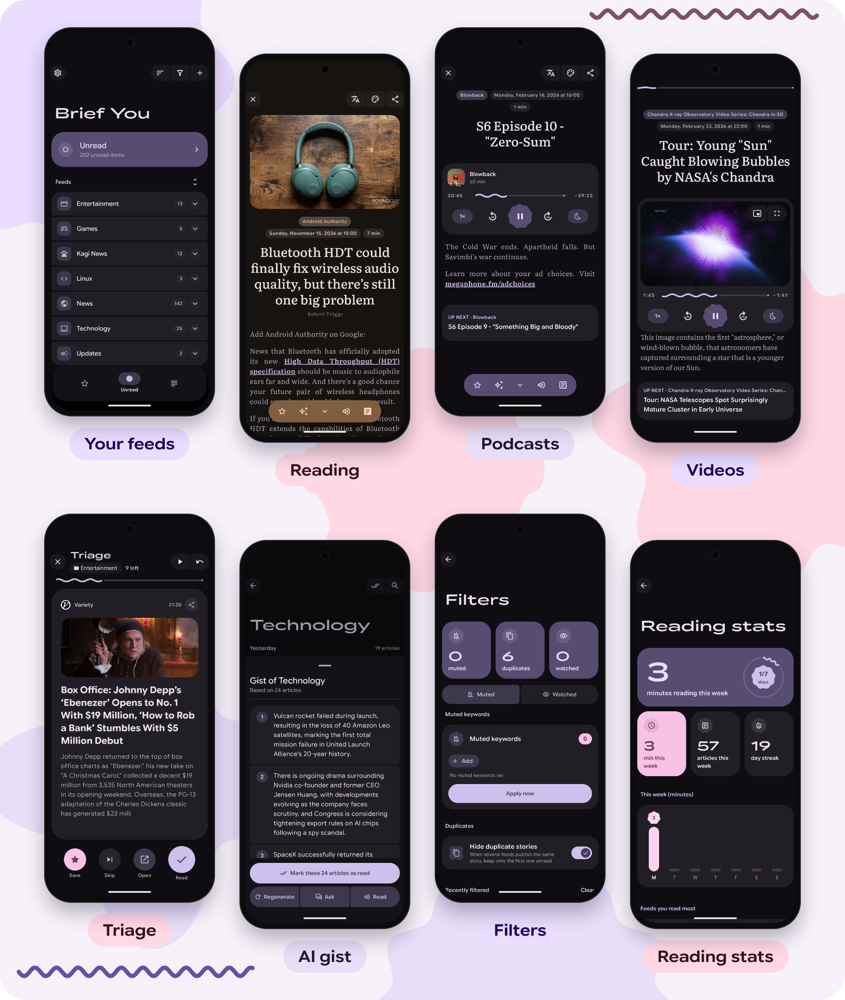</picture>

## What Brief You adds

<picture><source media="(prefers-color-scheme: dark)" srcset=".github/assets/readme/h-ai-dark.svg"></picture>

<picture><source media="(prefers-color-scheme: dark)" srcset=".github/assets/readme/t-ai-dark.svg">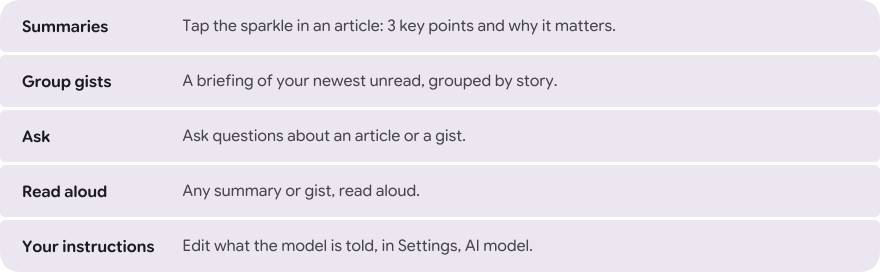</picture>

More details

- When a feed only sends a teaser, the summary, Ask and Triage's card summary fetch the full article first (and keep it, so opening the article is instant), so there's enough to summarise.
- Gists cover the newest 40 unread articles in a group, feed or everything.
- Your instructions cover article summaries, gists and Triage card summaries.
- Runs Google's Gemma model through [LiteRT-LM](https://github.com/google-ai-edge/LiteRT-LM). Nothing is sent to a server, and summaries are never saved.
- The model loads in the background a moment after you open the app, so AI answers without waiting (Google's advice for LiteRT-LM, whose loading can take up to 10 seconds):
  - it stays loaded while the app is open and unloads 3 minutes after you leave it;
  - it only loads ahead when the phone can afford it (not in battery saver, with battery to spare or charging, and enough free memory); otherwise it loads on first use;
  - if your phone's GPU can't run it (Pixels' Tensor chips can't), the app goes straight to the CPU, trying the GPU again after a month.
- Translate: the translate button in the reading page's top bar translates the article with your AI model, into your phone's language. Each paragraph replaces its original as soon as it is written, the ones still waiting are dimmed, and a wavy bar counts the paragraphs. Tap again to flip between the original and the translation; hold it to pick another language. Links and bold or italic words are kept where the model keeps their tags; if it breaks them, that paragraph is plain text. The page is patched in place paragraph by paragraph, so it doesn't reload or flicker. It is slower than an online translator, and it may make mistakes.
- Summaries open in a sheet at 70% of the screen. Each key point slides in as a card as it's written, and "Why it matters" gets its own accent card.
- Regenerate, Ask and Read are three connected buttons at the bottom of the sheet.
- Settings choices (initial page, swipe actions, fonts, sync interval, backups and the rest) are dialogs again, each with its own icon; long lists scroll inside with a fade at the edges. Tapping the dim area now closes every dialog, Add feed too.
- Sheets are never taller than 70% of the screen: they are as tall as what they hold up to that, and the rest scrolls.
- In the Filters sheet, tap *Muted*, *Duplicates* or *Watched* to filter today's list to that kind (the list says *Today · Duplicates*); tap it again to see all.
- The hero card's number rolls to its new value digit by digit, each digit sliding and fading into the next, so a sync's small steps only move the last digit; when a sync finishes the cookie gives one small pulse. Its words, sentence, greeting and the chip's colours fade over instead of jumping.
- On the Filters page the tiles (now the size of the Reading stats tiles, in the order Duplicates, Muted, Watched) decide what shows below, like those on the Reading stats page: the Duplicates tile shows the switch and the hidden duplicates, Muted the muted words and the muted articles, Watched the watched words and the watched articles (the tabs are gone). On Home, a feed's watched count is a plain number in a tertiary chip as big as its unread count; the eye badge stays by the group's name. All menus (article long-press, image viewer, Triage "Skip after") now share one look: cards with a normal shadow and no outline, and the screen behind is dimmed while a menu is open (tap it to close). The image viewer's menu is dark grey and leaves the picture undimmed. Only one hold-hint shows at a time. Text fields are rounded boxes whose hint rises onto the top edge as a small label chip when you tap or type. Dialogs put their icon and title on one line and use the same colours as sheets, so their rows stand out. The Home chip now fades smoothly from "offline" to "just now", and the oldest-article and "came out today" lines name the feed or group. The pull-up actions in the article list (Mark all as read, Next feed) follow your theme colours.
- Menus have a new look: pieces instead of one box. An article's long-press menu is **Mark above as read**, a strip of round buttons (read, star, share, newspaper; the ones that are on are lit) and **Mark below as read**. Triage's **Skip after** is a grid of six chips. The image viewer's menu has three round buttons: save, share the link and **share the image** itself. Hold a round button to see what it does, in a small bubble like the app's hints.
- Gists: tap the **AI button** beside the bottom bar of an *Unread* list and pick **AI Gist**. One tap marks all of them as read.
- Ask slides up a box for questions. Answers are short; the model may add general knowledge, and says when it does.

<picture><source media="(prefers-color-scheme: dark)" srcset=".github/assets/readme/h-reading-dark.svg"></picture>

<picture><source media="(prefers-color-scheme: dark)" srcset=".github/assets/readme/t-reading-dark.svg"></picture>

More details

- Toolbar long presses: Star marks read or unread, AI opens its settings, Next goes to the previous article, Full content opens the browser.
- Pictures in the text get a box of their own size with the app's shape-changing loading indicator, and fade in.
- Read later: share a link to *Read Later* (or to *Add Feed* to subscribe to its feed). The page is saved with its full text as a starred article in a *Saved Articles* feed; a small sheet confirms it and closes by itself. If the page can't be loaded (offline, blocked, or a file like a PDF), the link is saved instead. Local accounts only.
- Offline copies: every starred article (including Read later and Triage saves) keeps its pictures, and its full text for feeds set to Full content, on the phone, so it opens without the internet. Downloads in the background on Wi-Fi by default; a setting in Account → Syncing chooses off, mobile data only, Wi-Fi only or both. Unstarring removes the copy.
- App updates download inside the app: the update dialog's Download button fetches the new version in the background (with a progress notification that survives closing the app and dropped connections), then Install opens Android's installer. The first install may ask you to allow Brief You to install apps. A switch in Tips & support turns off the check for updates at start (tapping the version still checks).
- Newsletters read as feeds (through an email-to-feed service such as Kill the Newsletter) read like articles: the email's layout boxes, hidden preview text, tracking pixels, social links and preference footers are removed, its big text becomes headings, and sharing uses the issue's public web page instead of your private feed address. The **Tidy newsletters** switch (Settings → Reading page) adds more: wide banners and tracking images at the top are dropped, the headline isn't repeated under the title, email buttons (such as "Read more on CFR.org") stay as outlined buttons, and divider lines and bordered notes are kept. Off shows the plain article. Your text alignment and bold-heading settings are never overridden.
- Reading page settings that work in the web reader: **Subhead alignment** (Title page), **Image horizontal padding** and **Maximize**, and video rounded corners, horizontal padding and Maximize (corners and padding follow the image settings until you set them), all on one **Images and videos** page. "Mark as read button position" and "Rearrange buttons", which never worked, are hidden.
- **Settings tidied up:** the Feeds page and Flow page style pages are one **Lists** page (with *Always expand* and *Hide empty groups*, and a preview built from the app's own lists), Images and Videos are one **Images and videos** page, the four tonal elevation settings, the Content renderer (the web reader is the only one now) and Troubleshooting's JSON import/export (the backup already carries the settings) are gone, and *Hold the AI button* moved to the AI settings.
- **New settings:** **Keep screen on while reading**, **Mark as read when opened**, a **Haptic feedback** switch that silences every vibration, swipe actions **Share** and **Open in browser**, **Collect reading stats**, **Prepare the model at start** (AI settings), and a **Notifications** page (under Usage): the feeds that notify, each with a switch, and a button to Android's own notification settings.
- Tips & support is Brief You's own (your GitHub, bug reports go to Brief You's issues, with a credit to Read You and its GPL licence). Updates come from Brief You's releases: a Nightly follows the *nightly* release, a stable app the latest stable one. A new account starts without a default feed and says how to add one.
- Number settings (font size, line height, letter spacing, paddings, rounded corners) open as a sheet like the speed one: the value large between − and +, a slider, **Custom value** (type the number straight into the big value, even past the slider) and **Reset to the default**.
- **Usage → Triage**: choose what auto-advance does when a card's time is up (skip, mark as read or save) and how long it waits. In Triage, the groups sheet also has **Mark as read** beside Skip (marks the cards left in the group as read, then goes on), the next-up card shows the group's own icon, and the card passes over the buttons when you drag it down.
- Searching articles also matches the feed's name and the article's author, not just its title and text.
- The filtered list (Settings → Filters) shows when each article was caught, and earlier days sit under a row per month, all closed to start; a month opens to its days and a day opens to its articles.
- Tidier articles also drop "appeared first on" lines.
- Large header picture; feed, date and reading time as chips; title, time left and a wavy progress bar in the top bar once you scroll.
- Pictures: drag one away to close it; tap it to hide or show its buttons; Save and Share in its menu; slightly dimmed in dark mode.
- Newspaper: hold Share at the top of an article (or pick *Share as newspaper* in an article's long-press menu) to share it as a newspaper front page:
  - the feed's name as the masthead, the date and site on the dateline, and the headline;
  - the lead picture in black and white with a faint dot screen, like newsprint;
  - the AI's 3 points boxed as *In brief*, and the opening lines in two columns;
  - a zig-zag cut at the top and bottom; always drawn 1600 pixels wide, so it stays sharp in messaging apps (send it in HD on WhatsApp).
- While it's made, a dialog shows the steps (getting the full article, writing *In brief*, setting the page). The title and link go with the picture.
- Selected text and its handles use your accent colour.
- Feeds that only send a teaser show no reading-time estimate rather than a wrong one.
- Articles without a colourful picture keep your theme's colours.

<picture><source media="(prefers-color-scheme: dark)" srcset=".github/assets/readme/h-listen-dark.svg"></picture>

<picture><source media="(prefers-color-scheme: dark)" srcset=".github/assets/readme/t-listen-dark.svg">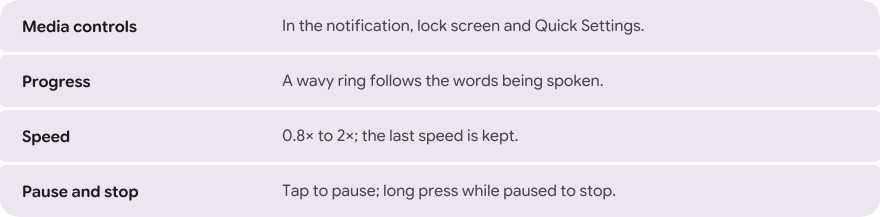</picture>

More details

- The notification shows the title, play/pause, Stop, speed and a progress bar you can drag.
- Long press: speech settings before reading, the speed slider while reading, stop while paused.
- Closing the article keeps an article's read aloud going: the now-playing pill (the feed's icon, tap to open the article, swipe it away to stop) and the notification control it. Closing the AI sheet stops a summary's reading.
- Each read aloud button controls only its own reading: the article's or the summary's.

<picture><source media="(prefers-color-scheme: dark)" srcset=".github/assets/readme/h-media-dark.svg"></picture>

<picture><source media="(prefers-color-scheme: dark)" srcset=".github/assets/readme/t-media-dark.svg"></picture>

More details

- A podcast episode or a video attached to a feed item gets a player under the article's title. Audio and video share one compact layout: the progress with the times beside it, then speed (0.8× to 3×, kept for next time, separately for podcasts and videos, in its own sheet), back and forward 30 seconds, play and a sleep timer (its own sheet: 15, 30, 45 minutes, an hour, or the end of the episode; it waits while paused and fades out over its last seconds).
- YouTube videos inside an article show as a card (the video's picture with a play button in your accent colour and a YouTube label) that opens the video in the YouTube app; YouTube no longer plays videos embedded in app pages.
- Episodes and videos carry on where you stopped. Opening one doesn't mark it as read, so a partly heard episode isn't cleared away with old read articles; it's marked as read once it's played past the share you choose in *Settings → Usage → Audio and video* (90% by default).
- Episodes and videos have their own media notification (lock screen, Quick Settings, headphone buttons) with speed · back 30 · the progress bar · forward 30 · stop; the speed button shows the speed as a number (read aloud's too); read aloud keeps its own. Only one plays at a time. Tapping either notification opens the article that is playing. After a restart, Android's resume button on the lock screen or in Quick Settings picks up the last episode where you left it.
- A file that can't be played says so, with *Try again* and *Open in browser*. The app only uses secure connections: an `http://` episode is tried as `https://` first.
- While something plays, a pill above the bottom bar shows it with its progress, play/pause and close; tap it for the full controls (a video shows there, large). Read aloud shows there too.
- Full screen has speed and the sleep timer too, and its controls hide after 3 seconds while playing.
- Tap a video to play or pause it. Videos play in the article in their own shape (kept for next time), with picture-in-picture and full screen on the video's corner; full screen turns sideways for wide videos and stays upright for tall ones, and picture-in-picture takes the video's shape; leaving the app while a video plays opens picture-in-picture by itself.
- The play button is Expressive: a circle while paused, a slowly turning cookie while playing, with a bounce; the other buttons spring in once an episode is loaded, and dragging the progress ticks once a second. Videos have the same play button, buttons and ticks, and their full-screen controls slide in and out from the edges.
- A feed item that links to its comments gets a *Comments* chip next to its date.
- Podcast audio files are no longer taken as a list picture.
- A feed can use its own picture (a podcast's cover) instead of its website's icon: *Feed's picture* | *Website icon* in Add a feed (the feed's picture by default) and in a feed's Change icon (for feeds added earlier, once they have synced). The choice stays through syncs.
- An episode or video without a picture of its own shows its feed's icon.

<picture><source media="(prefers-color-scheme: dark)" srcset=".github/assets/readme/h-triage-dark.svg"></picture>

<picture><source media="(prefers-color-scheme: dark)" srcset=".github/assets/readme/t-triage-dark.svg"></picture>

More details

- Open it with the **AI button** beside the bottom bar of an *Unread* list (tap, then **Triage**; or just hold the button). Undo takes back your last choice.
- Summary: the card sinks a little and its border glows in Google's AI colours while the 3 key points are written. Tap the card to switch between the summary and the article's description.
- The run bar has one piece per group, sized by its cards and filled as far as you got. When a group is done you see a ring with how much of your unread is cleared ("3 of 4 groups clear"), what's left and the next group, which starts by itself after a countdown while auto-advance is on.
- The card picture you share (hold Share) always includes the article's image when it has one, also when the card shows its summary.
- The top bar counts the cards as *12/40 left*; the words after the number stay put while it counts down.
- *All caught up* only when nothing is unread anywhere, including cards you skipped or left behind, with the run's read, saved and skipped totals (skipped = swiped down; cards left behind by jumping aren't skipped).
- The groups sheet lists every group in the run, laid out like the Feeds page: jump to any of them, or skip this one. Cards you leave stay unread. The arrow on a group opens its feeds; tap a feed to Triage just that feed, and the run carries on through the next feeds. Undo on that feed's first card returns to the group. In a run of feeds the sheet lists the groups too, with the feed you're on open inside its group: tap a group to go back to it, or another feed to switch.
- Top right, Auto-advance and Undo share one joined pill, like the other screens; while auto-advance runs it becomes a circle with its countdown ring.
- The shared picture is drawn just for sharing: the feed and date, the picture, title and a few lines (or the summary's points), the site and the Brief You icon, on a soft backdrop in your colours.
- The four buttons at the bottom and the Next up card squeeze when pressed and spring back.
- Auto-advance pauses while you hold a card, while a card shows its summary and while the groups sheet is open: the button turns grey and its ring stops where it was, then carries on. Long press the button (in the pill or as the circle) to choose the delay (3–30 s, 5 by default).
- Haptics mark the swipe threshold, each choice, Undo and finishing the stack.
- Undo on the first card of a group goes back into the group before it and takes back its last card.
- When a group is done, its bar shrinks into its piece of the run while the other groups' pieces fade in; starting the next group, its piece grows back into the bar.
- The long-press glow only starts once your finger has stayed still for a moment, so swiping never shows it.
- When no untouched group is left but you left cards in one (jumped away, or skipped some), the end screen offers *Back to* that group with how many are left; it never starts by itself.
- Big groups are loaded in full: as a group starts (and near its end) Triage adds any unread cards the stack doesn't have yet.
- Next groups follow your Feeds order. The back gesture turns Triage into a card that follows your finger and is tossed aside.
- Inbox zero also plays when you swipe up to mark everything read on the Unread list.

<picture><source media="(prefers-color-scheme: dark)" srcset=".github/assets/readme/h-calm-dark.svg"></picture>

<picture><source media="(prefers-color-scheme: dark)" srcset=".github/assets/readme/t-calm-dark.svg">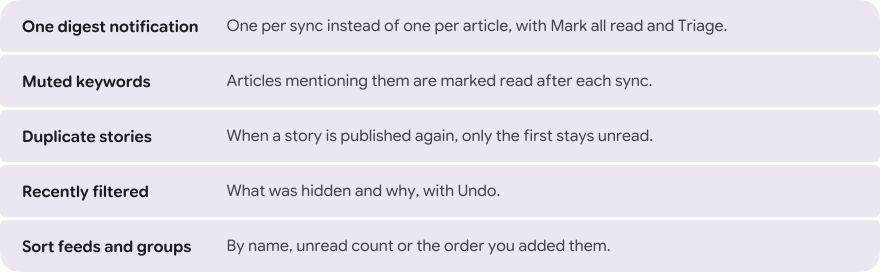</picture>

More details

- Watched words are the opposite of muted keywords (on the Filters page). An unread article with one in its title:
  - gets a small chip with the word in lists and on its Triage card;
  - comes first in Triage and in the digest ("2 about Pixel, Gemma");
  - is counted on its feed and group at home, and is never muted.
- Tap a watched word to stop watching it. *Recently watched* keeps 30 days.
- The Filters page has two tabs, *Muted* (with *Hide duplicate stories*) on the left and *Watched* on the right, under tiles counting what was muted, merged and watched. Each tab has its words, *Apply now* and a recent list laid out the same way: today in full, earlier days grouped by word.
- *Apply now* checks the last 3 days and says what it did ("3 hidden", "2 found").
- The digest reads like "12 new articles · Variety, Kotaku, Kagi News +2".
- Duplicates: another feed, or the same feed twice. Filters lists the hidden copies under the story they repeat, and which copy was kept unread.
- Recently filtered shows today in full; earlier days are grouped by reason (*Duplicate stories*, then each muted keyword) with a count, and open to show 5 articles at a time.
- The digest lists one line per feed, so busy feeds never push the others out. Android shows at most 6 lines, so with more than 6 feeds it shows 5 and a line naming the rest ("+3 more: XKCD, Reddit Comics, Wikipedia").
- A copy is a very similar title from another feed within 48 hours, so repeating headlines like weekly roundups aren't caught.
- Undone articles aren't filtered again; *Reset undone articles* lets the filters catch them.
- The sort is used everywhere: Triage's next group, OPML exports and the backup.
- Filters live in *Settings → Filters*.

<picture><source media="(prefers-color-scheme: dark)" srcset=".github/assets/readme/h-look-dark.svg"></picture>

<picture><source media="(prefers-color-scheme: dark)" srcset=".github/assets/readme/t-look-dark.svg"></picture>

More details

- The group arrows (the one on each group and the open-all button on the Feeds page, and in Triage's groups sheet) turn over or fade into each other when a group opens or closes.
- Expressive loading and pull-to-refresh. Back buttons and Triage's close button are the same tonal circle. In Feeds and Settings, the big title moves into the top bar as you scroll.
- Reading fonts: Google Sans Flex, Literata, system, or your own.
- Built for Android 17 (API 37): if a FreshRSS/Miniflux server or a feed is on your home network (an address like 192.168.x.x or a .local name), Brief You asks once for the new *local network* permission, so syncing keeps working. Plain http addresses still work.
- English only: translations are left out, which with slimmer fonts and a compressed AI library makes the download about 15 MB smaller.
- An emoji chosen as a feed's icon sits on a round background in the feed's name colour (taken from the emoji), like the other icons.
- A pale or grey feed icon gets a steady colour of its own. Icons are cached and loaded at the size they're shown; a site without an icon is searched again once a week.
- Reading stats are in *Settings → Reading stats*: this week Monday to Sunday (a bar per day), articles read, your streak, top feeds, and this month compared with last.
- Monthly recap: for the first week of a month it sits at the top of Reading stats:
  - the articles you read (and the change from the month before), a row of daily bars and four highlights;
  - tap it and the bars slide into a calendar (tap a day for its numbers), with every highlight: busiest day, top feed, longest streak, reading time, Triage and what the filters hid;
  - share it as a picture of the card as it is, or hide it with ✕.
- A slim version shows above your feeds on home (off with *Monthly recap on home*), and *Past months* keeps about a year of recaps.
- Year in review: for the first week of January, last year takes the monthly recap's place:
  - twelve month bars and four highlights (best month, longest streak, reading time, Triage);
  - tap it and each bar breaks into its days, which fly into twelve little calendars; tap a day for its numbers.
- It shares, hides and shows on home the same way, and stays at the top of *Past months* after that week.
- First run: a page to restore a backup made with *Back up everything* (feeds, starred articles, filters and settings, for someone coming from another phone; also in the tour from Settings), the on-device AI with a check of your phone, then the tour (Triage, calmer feeds, and the buttons that do more when held) as its own welcome page; its agreement is on the last page. One Expressive shape morphs from page to page as you swipe. See it again from the tour button in *Settings → Tips & support*.
- One-time hints: a small bubble the first time you reach Triage, the AI button and the Unread list's Triage button; *Got it* and it's gone (*Show hints again* in *Settings → Tips & support*).
- Redesigned home: one top row (account name, then Sort, Add and Settings as one pill; the red dot on Settings means an app update), a compact hero card (greeting in capitals, when you last synced, the exact count in a still cookie with faint moving cookies behind it, and a short sentence), joined group cards with a big count and up to three feed icons, and a floating bottom bar whose pill follows your swipe and finger, with a small wobble. Feed icons are now kept in the app's own folder so they stop downloading again.
- The hero card on home also tells what is going on: while a sync runs it shows how far it is ("17 of 40" in the sync chip, which fills up as it goes, for accounts that fetch feeds themselves), "offline" when the phone has no connection, "failed · retry" after a sync that failed (tap to try again) and "sign in" when the server no longer accepts the account (tap to open the account). On the Unread page it says how many articles are new since you last opened Brief You, "oldest is N days old" when the oldest unread article is a month old or more, and "mostly from <feed>" when everything unread is in one group.
- Above the groups, a big feed count with "feeds in N groups" and the expand-all pill. Tapping the hero card gives a short vibration as it opens the article list.
- More on the hero card: until the first sync has finished it shows dots and "first sync" instead of a wrong "caught up"; on All it says how many articles came out today; "mostly in <group>" appears only when that group holds at least 40% of the unread, otherwise "<group> has the most" (the Starred page names its group the same way); "offline" also covers a Wi-Fi without internet; "2m ago" and the greeting keep up while the app stays open; tapping the card gives a short vibration. Above the groups a big feed count says "68 feeds in 11 groups".
- Sheets and dialogs follow the home design: sheets have bigger top corners, a cookie icon in the head, accent section labels and round buttons (delete in a soft red); dialogs are rounder with the icon on a cookie at the left, a round filled main button (red when it deletes or clears something) and a plain Cancel. The summary, translate, sort, sleep timer and newspaper sheets use the same head with their own icon, and text fields are filled and rounded. The group and feed sheets start with one head card (the group's cookie or the feed's picture with a pencil badge to change it, the name with a round pencil to rename it, the feed count or the address); the settings, the groups to move to and the buttons follow, and the buttons stay at the bottom while the rest scrolls. "Apply to all" in a group asks in the same dialog style. A group's pencil renames it; a feed's pencil edits its name and, on accounts that allow it, its address, in one dialog.
- *Add a feed* reads left-aligned with a filled address field and a round Search button; the *Sort feeds* sheet uses the sheet language (accent labels, 16 dp sides, A–Z / Z–A as joined buttons).
- The top-bar filter button opens a short *Filters* sheet: the muted, duplicate and watched tiles and today's filtered articles (one card each, with Undo), with *Apply now* and *All filters* below. *Accounts* and the AI prompt editors are sheets too, *Translate to* opens to 70% of the screen, and one text-box style is used everywhere. Dialogs fade out when they close.
- Deleting a feed also deletes its saved icon, unless another feed uses the same one.
- Tiles and cards (Filters, Reading stats, the sort tiles and the recaps) squeeze and spring back when pressed, like Triage's buttons.
- One card style everywhere: the feeds page shows groups as one joined list with icon tiles (a folder, or a Material icon, emoji or image you pick in the group's options) and compact feed rows, article lists count each day's articles in a header that gets a hairline while it's pinned, and every settings page groups its rows into joined cards. Empty lists say so (*Nothing starred yet*, *All caught up*).
- *Add a feed* is a floating dialog in the same design. The options you get by holding a feed or group are the app's bottom sheets: icon and name on top (a pencil changes a feed's address), its settings as three tiles, groups as one sideways row of chips, and Clear / Unsubscribe as two buttons.
- The bottom bar is a solid tonal toolbar, like Material's floating toolbar (Starred / Unread / All; the chosen one shows its name in an accent pill): the list scrolls on underneath it. On *Unread*, the AI button sits on its right (the two are centred together, like Material's floating toolbar with a button): a tap opens AI Gist and Triage, holding it opens the one chosen in *Settings → AI settings* straight away (the button shows that one's icon).
- Every other sheet looks the same: a title with a muted line under it, a divider, and its choices as one joined group with the chosen one filled and ticked. That includes every setting with a few choices (they used to be dialogs), the reading *Text* sheet (a live preview in your font, the sizes as one joined group, font and alignment as joined buttons, each font name in its own font), *Translate to* (each language in its own name), and the number and speed sheets (the value large between − and +, and quick picks for speed).
- Predictive back uses a gentler dim on the screen behind, so it never flashes dark.
- Wide headings use Google Sans Flex at its widest; long names shrink or wrap to fit.
- AMOLED black still works on top of any colours.
- Custom feed icons survive syncs and are saved in OPML exports (with additional info) and the backup.
- The splash takes about 1.3 s, only on fresh launches, and is skipped when animations are off.
- A baseline profile makes the app smooth from the first run after each update.
- Lists load without the articles' text (it's read when you open one), sort through an index, and start loading as soon as you press a feed, a group or a place in Triage.

<picture><source media="(prefers-color-scheme: dark)" srcset=".github/assets/readme/h-backup-dark.svg"></picture>

<picture><source media="(prefers-color-scheme: dark)" srcset=".github/assets/readme/t-backup-dark.svg">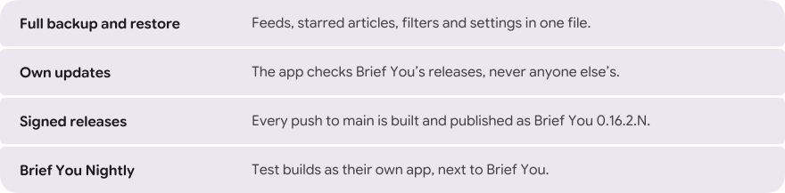</picture>

More details

- The backup also has sync settings and AI instructions.
- *Account → Advanced → Automatic backup* saves the same backup into a folder you pick, daily or weekly (off by default), while the phone charges. It keeps the newest 5 files (1 to 30), and *Back up now* makes one right away. The files outlive the app.
- Every other branch is built as **Brief You Nightly**, with a night-sky icon, published as the one *Nightly* prerelease.
- Back up in *Account → Advanced → Back up everything*. It also includes custom feed and group icons, feed and group order, the Triage delay and the read-aloud speed.
- Restore adds everything back on any phone: feeds you already have are kept, feeds go into your existing groups, and starred articles come back even if their feed dropped them. Server logins and the AI model aren't included.
- Release names are the version plus a rising build number, so each APK installs as an update (works with Obtainium).
- APKs are for 64-bit ARM phones (arm64-v8a).
- Builds are signed with Brief You's own key when the repository has the `KEYSTORE_BASE64`, `KEYSTORE_PASSWORD` and `KEY_ALIAS` secrets.
- Read You watch: a weekly workflow opens an issue when Read You has new commits (see below). Nothing is merged.
- Brief You Nightly (app ID `com.ay.briefyou.nightly`) has its own data and its own build numbers, so test builds never use up release numbers. Each test build replaces the *Nightly* prerelease, and it doesn't offer Brief You's releases as updates.
- To tidy up, run **Actions → Clean up old releases, tags and runs** by hand. It keeps only the latest of everything: the newest release (and the Nightly), the newest run of each workflow, the kept releases' tags, and branches with work not yet in main (merged branches are deleted). It starts as a dry run that only lists what it would delete.

## Setting up the AI

1. Open **Settings → AI model** and tap **Download** (or **Set up AI** in the first-run tour). A quick check shows whether your phone has the memory and room for it, and warns on mobile data.
2. Gemma 4 E2B (about 2.6 GB) downloads from Hugging Face in the background, with a notification; it carries on if you leave the app and picks up where it stopped if the connection drops.
3. Tap ✨ on any article. The first answer takes a few seconds while the model loads.

Already have the file? **Import** picks a `gemma-4-E2B-it.litertlm` you downloaded yourself.

## How Brief You is organised

Brief You is built on [Read You](https://github.com/ReadYouApp/ReadYou) and keeps its GPL-3.0 licence, but it's now its own app and no longer follows Read You's development.

- **Brief You's own code** lives in `app/src/main/java/com/ay/briefyou/brief/` (and its own resources, such as `strings_fork.xml`). The rest started as Read You's code and is now changed like any other part of the app.
- A weekly workflow (*Read You watch*) opens an issue, *Read You changes to look at*, when Read You has new commits, with changes to account syncing, feed parsing, the database and security listed first. Nothing is merged; useful fixes are copied over by hand.

## About this project

- **A personal fork.** Brief You is a personal project by one person, made for their own use and shared as is. It isn't affiliated with, endorsed by or supported by Read You or its authors, so please don't report Brief You's problems to them; open an issue here instead.
- **Built with AI.** The code, the design work and this README are written with the help of an AI assistant (Claude, by Anthropic), directed, reviewed and tested by the owner. Expect the occasional mistake, and report what you find.
- **The AI inside the app is separate.** Summaries, gists and Ask come from Gemma running on your phone; nothing is sent to a server (see *On-device AI*).

## Building

Open the project in [Android Studio](https://developer.android.com/studio) and run it, or build from the command line with `./gradlew assembleGithubRelease` (Brief You Nightly: `./gradlew assembleGithubNightly`).

## Credits and license

Brief You is built on [**Read You**](https://github.com/ReadYouApp/ReadYou) by [Ashinch](https://github.com/Ashinch) and its contributors. All credit for the original app goes to them, and Brief You picks up its updates. If you like the app, consider [supporting Read You](https://ash7.io/sponsor).

Free software under the [**GNU GPL 3.0**](LICENSE). Gemma is provided under Google's Gemma terms; Brief You doesn't include the model, you download it yourself. The README's pictures use [Material Symbols](https://github.com/google/material-design-icons) (Apache 2.0) and Google Sans Flex.
