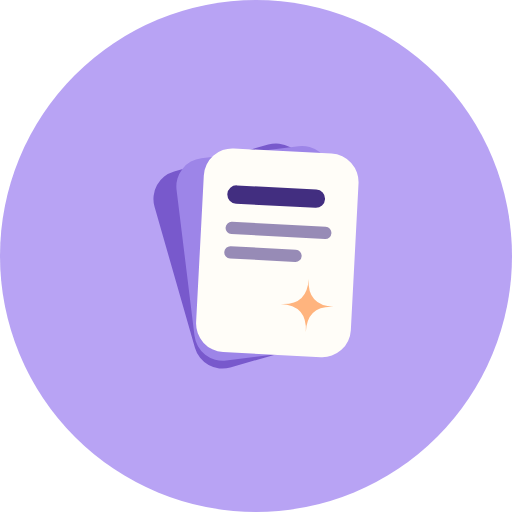
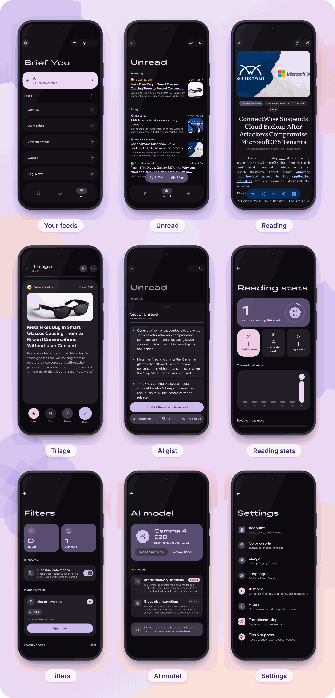

<h1>Brief You</h1>

<b>A calm, private RSS reader for Android, with AI that runs on your phone.</b> 
A fork of <a href="https://github.com/ReadYouApp/ReadYou">Read You</a>.

<a href="../../releases/latest"><picture><source media="(prefers-color-scheme: dark)" srcset=".github/assets/badges/download-dark.svg"></picture></a>
<a href="https://apps.obtainium.imranr.dev/redirect?r=obtainium://add/https://github.com/Humorist2601/BriefYou"><picture><source media="(prefers-color-scheme: dark)" srcset=".github/assets/badges/obtainium-dark.svg"></picture></a>

<picture><source media="(prefers-color-scheme: dark)" srcset=".github/assets/badges/ai-dark.svg"></picture>
<picture><source media="(prefers-color-scheme: dark)" srcset=".github/assets/badges/private-dark.svg"></picture>
<picture><source media="(prefers-color-scheme: dark)" srcset=".github/assets/badges/android-dark.svg"></picture>
<picture><source media="(prefers-color-scheme: dark)" srcset=".github/assets/badges/license-dark.svg"></picture>

<table>
<tr>
<td align="center" width="33%">✨ <b>On-device AI</b> Summaries, group gists and Ask, all private</td>
<td align="center" width="33%">🃏 <b>Triage</b> Swipe through a backlog, card by card</td>
<td align="center" width="33%">🔊 <b>Read aloud</b> Like a music app, with speed and progress</td>
</tr>
<tr>
<td align="center">🔕 <b>Calmer feeds</b> One digest, muted words, no duplicates</td>
<td align="center">🎨 <b>Material 3 Expressive</b> Wavy, shaped, colourful, smooth</td>
<td align="center">💾 <b>Full backup</b> Everything in one file</td>
</tr>
</table>

Brief You keeps everything that makes Read You great (Material You design, Reeder-style reading, FreshRSS, Miniflux, Fever, Google Reader API and more) and adds AI that runs **entirely on your phone**: articles and questions never leave it. It installs **next to** Read You (app ID `com.ay.briefyou`); move your feeds over with OPML.

## What's different from Read You

### ✨ On-device AI

| Feature | What it does |
| --- | --- |
| **Summaries** | Tap ✨ in an article: 3–5 key points and why it matters. |
| **Group gists** | A briefing of the newest 40 unread articles in a group, feed or everything, grouped by story. |
| **Ask** | Ask questions about an article or a gist. |
| **Read aloud** | Any summary or gist can be read aloud. |
| **Your instructions** | Edit exactly what the model is told, in *Settings → AI model*. |

More details

- Runs Google's Gemma model through [LiteRT-LM](https://github.com/google-ai-edge/LiteRT-LM). Nothing is sent to a server, and summaries are never saved.
- The model starts loading in the background when you open an article or an *Unread* list, so ✨ answers without waiting for it, and it unloads after 3 idle minutes. If your phone's GPU can't run it, the app remembers and goes straight to the CPU next time.
- Summaries open in a sheet at 70% of the screen. Each key point slides in as a card as it's written, and "Why it matters" gets its own accent card.
- Regenerate, Ask and Read are three connected buttons at the bottom of the sheet.
- Gists: tap **AI gist** in the floating button at the bottom of an *Unread* list. One tap marks all of them as read.
- Ask slides up a box for questions. Answers are short; the model may add general knowledge, and says when it does.

### 📖 Reading

| Feature | What it does |
| --- | --- |
| **Colours from the picture** | The reading page takes its colours from the article's picture, like music apps with album art. |
| **Floating toolbar** | Star, AI, next article, read aloud and full content, in a pill that hides while you scroll. |
| **Toolbar long presses** | Star: read or unread · AI: settings · Next: previous article · Full content: open in browser. |
| **Quick text sheet** | Size, line height, margins, font and justify, changed live. |
| **Steady pictures** | Pictures in the text get a box of their own size with a loading indicator and fade in, so the text never jumps. |
| **Next article card** | At the end of an article, or "You're all caught up". |
| **Reading time** | `4 min` in the list and on the page. |
| **Tidier articles** | No share buttons, "Read more" links, "appeared first on" lines or tracking pixels. |

More details

- Large header picture; feed, date and reading time as chips; title, time left and a wavy progress bar in the top bar once you scroll.
- Pictures: drag one away to close it; Save and Share in its menu; slightly dimmed in dark mode.
- Selected text and its handles use your accent colour.
- Feeds that only send a teaser show no reading-time estimate rather than a wrong one.
- Articles without a colourful picture keep your theme's colours.

### 🔊 Read aloud

| Feature | What it does |
| --- | --- |
| **Media controls** | In the system media notification, lock screen and Quick Settings, in the page's colour. |
| **Progress** | A wavy ring on the read aloud buttons follows the words being spoken. |
| **Speed** | 0.8× to 2× in steps of 0.2; the last speed is kept. |
| **Pause and stop** | Tap to pause or play; long press while paused to stop. |

More details

- The notification shows the title, play/pause, Stop, speed and a progress bar you can drag.
- Long press: speech settings before reading, the speed slider while reading, stop while paused.
- Closing the article (or the AI sheet, for a summary) stops it; leaving the app keeps it going.
- Each read aloud button controls only its own reading: the article's or the summary's.

### 🃏 Triage

| Feature | What it does |
| --- | --- |
| **Card stack** | Swipe right: read · left: save · up: open · down: skip. Undo takes back your last choice. |
| **Auto-advance** | Skips each card after a few seconds, with a wavy ring counting down. |
| **Next group** | When a group (or feed) is done: a ring with how much of all your unread is cleared ("3 of 4 groups clear"), what's left, and the next group, which starts by itself after a countdown while auto-advance is on. *All caught up* only when nothing is unread anywhere. |
| **Inbox zero** | A little celebration when you're all caught up. |

More details

- Open it with **Triage** in the floating button at the bottom of an *Unread* list.
- Auto-advance pauses while you hold a card; long press its button to choose the delay (3–30 s, 5 by default).
- Haptics mark the swipe threshold, each choice, Undo and finishing the stack.
- Next groups follow your Feeds order. The back gesture turns Triage into a card that follows your finger and is tossed aside.
- Inbox zero also plays when you swipe up to mark everything read on the Unread list.

### 🔕 Calmer feeds

| Feature | What it does |
| --- | --- |
| **One digest notification** | "12 new articles · From 5 feeds", once per sync, instead of one per article. |
| **Muted keywords** | Unread articles mentioning them are marked read after each sync. |
| **Duplicate stories** | When the same story is published again (by another feed, or twice by the same feed), only the first stays unread. Filters lists the hidden copies under the story they repeat. |
| **Recently filtered** | Today's hidden articles and why (for duplicates, which copy was kept unread and which were hidden), with Undo; earlier days under *Earlier*. |
| **Sort feeds and groups** | By name, unread count or the order you added them. |

More details

- The digest lists one line per feed, so busy feeds never push the others out.
- A copy is a very similar title from another feed within 48 hours, so repeating headlines like weekly roundups aren't caught.
- Undone articles aren't filtered again; *Reset undone articles* lets the filters catch them.
- The sort is used everywhere: Triage's next group, OPML exports and the backup.
- Filters live in *Settings → Filters*.

### 🎨 Look and feel

| Feature | What it does |
| --- | --- |
| **Material 3 Expressive** | Shape-morphing buttons, shaped icons, Expressive loading and pull-to-refresh, wavy progress. |
| **Google Sans Flex** | Rounded throughout, with wide headings. Reading fonts: Google Sans Flex, Literata, system, or your own. |
| **Material You, the current way** | Uses the system's own wallpaper colours; preset colours use Google's latest colour spec. |
| **Feed colours and icons** | Feed names take a colour from their icon; set an emoji or your own image as a feed's icon. |
| **App shortcuts** | Long-press the icon for Triage, AI gist, Unread or Sync now. |
| **Reading stats** | This week Monday to Sunday (a bar per day), articles read, your streak, top feeds, and this month compared with last month, in *Settings → Reading stats*. |
| **Swipe between Starred, Unread and All** | Each with its own list and scroll position. |
| **Predictive back** | Android's own back animation, in screens and dialogs, with a gentler dim on the screen behind so it never flashes dark. |
| **New icon and animated splash** | A fanned stack of cards that grows into the app. |

More details

- Wide headings use Google Sans Flex at its widest; long names shrink or wrap to fit.
- AMOLED black still works on top of any colours.
- Custom feed icons survive syncs and are saved in OPML exports (with additional info) and the backup.
- The splash takes about 1.3 s, only on fresh launches, and is skipped when animations are off.
- A baseline profile makes the app smooth from the first run after each update.

### 💾 Backup and updates

| Feature | What it does |
| --- | --- |
| **Full backup and restore** | One file with subscriptions, starred articles, filters, sync and app settings, AI instructions and more. |
| **Own updates** | The app checks Brief You's releases, never Read You's. |
| **Signed releases** | Every push to `main` is built and published as **Brief You 0.16.2.N**. |
| **Brief You Nightly** | Every other branch is built as **Brief You Nightly**, its own app with a night-sky icon that installs next to Brief You, published as the one *Nightly* prerelease. |
| **Reviewed Read You updates** | Read You's changes arrive daily as a pull request, released only once you merge it. |

More details

- Back up in *Account → Advanced → Back up everything*. It also includes custom feed icons, feed and group order, the Triage delay and the read-aloud speed.
- Restore adds everything back on any phone: feeds you already have are kept, feeds go into your existing groups, and starred articles come back even if their feed dropped them. Server logins and the AI model aren't included.
- Release names are Read You's version plus a rising build number, so each APK installs as an update (works with Obtainium). The notes say which Read You version a build is based on.
- APKs are for 64-bit ARM phones (arm64-v8a).
- Builds are signed with Brief You's own key when the repository has the `KEYSTORE_BASE64`, `KEYSTORE_PASSWORD` and `KEY_ALIAS` secrets.
- Read You updates: a daily workflow merges Read You's new commits into a `read-you-sync` branch and opens (or updates) a pull request called *Read You update*. Nothing is built or signed until you merge it. For the pull request to open by itself, allow it in *Settings → Actions → General → Allow GitHub Actions to create and approve pull requests*.
- Brief You Nightly (app ID `com.ay.briefyou.nightly`) has its own data and its own build numbers, so test builds never use up release numbers. Each test build replaces the *Nightly* prerelease, and it doesn't offer Brief You's releases as updates.
- To tidy up, run **Actions → Clean up old releases, tags and runs** by hand. It keeps the newest 5 releases (never the Nightly one) and 10 runs per workflow, deletes release tags no kept release uses, and starts as a dry run that only lists what it would delete.

## Setting up the AI

1. Open **Settings → AI model** and tap **Download Gemma 4 E2B**. On Hugging Face, download `gemma-4-E2B-it.litertlm` (about 2.6 GB).
2. Back in the app, tap **Import model file** and pick it. It's copied into the app; you can delete the download afterwards.
3. Tap ✨ on any article. The first answer takes a few seconds while the model loads.

## How Brief You is organised

Brief You is kept apart from Read You so Read You's updates merge easily:

- **Brief You's own code** lives in `app/src/main/java/me/ash/reader/brief/` (and its own resources, such as `strings_fork.xml`). Read You never touches these files, so they never conflict.
- **Read You's files** are changed only with small hooks, each marked `Brief You`, so a conflict always shows whose line is whose.
- **Rewritten Read You files** (the reading toolbar, top bar, filter bar, web view, read aloud…) have Brief You's own copy instead; Read You's original stays untouched. They're listed in `.github/fork/copies.txt`, and each *Read You update* pull request lists the ones Read You changed, to copy over by hand.
- `.github/fork/fork_check.py` checks this: every build warns about unmarked changes to Read You's files, and each update pull request includes a merge-risk report.

## Building

Open the project in [Android Studio](https://developer.android.com/studio) and run it, or build from the command line with `./gradlew assembleGithubRelease` (Brief You Nightly: `./gradlew assembleGithubNightly`).

## Credits and license

Brief You is built on [**Read You**](https://github.com/ReadYouApp/ReadYou) by [Ashinch](https://github.com/Ashinch) and its contributors. All credit for the original app goes to them, and Brief You picks up its updates. If you like the app, consider [supporting Read You](https://ash7.io/sponsor).

Free software under the [**GNU GPL 3.0**](LICENSE). Gemma is provided under Google's Gemma terms; Brief You doesn't include the model, you download it yourself.
