

<picture><source media="(prefers-color-scheme: dark)" srcset=".github/assets/readme/hero-dark.svg">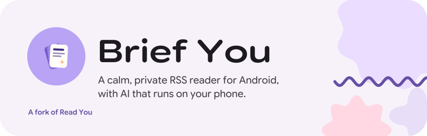</picture>

<a href="../../releases/latest"><picture><source media="(prefers-color-scheme: dark)" srcset=".github/assets/badges/download-dark.svg"></picture></a>
<a href="https://apps.obtainium.imranr.dev/redirect?r=obtainium://add/https://github.com/Humorist2601/BriefYou"><picture><source media="(prefers-color-scheme: dark)" srcset=".github/assets/badges/obtainium-dark.svg"></picture></a>

<picture><source media="(prefers-color-scheme: dark)" srcset=".github/assets/badges/ai-dark.svg"></picture>
<picture><source media="(prefers-color-scheme: dark)" srcset=".github/assets/badges/private-dark.svg"></picture>
<picture><source media="(prefers-color-scheme: dark)" srcset=".github/assets/badges/android-dark.svg"></picture>
<picture><source media="(prefers-color-scheme: dark)" srcset=".github/assets/badges/license-dark.svg"></picture>

<picture><source media="(prefers-color-scheme: dark)" srcset=".github/assets/readme/card-ai-dark.svg">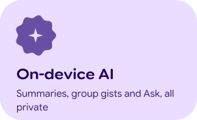</picture>
<picture><source media="(prefers-color-scheme: dark)" srcset=".github/assets/readme/card-triage-dark.svg">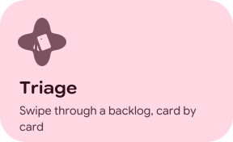</picture>
<picture><source media="(prefers-color-scheme: dark)" srcset=".github/assets/readme/card-listen-dark.svg">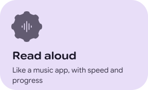</picture>
<picture><source media="(prefers-color-scheme: dark)" srcset=".github/assets/readme/card-calm-dark.svg">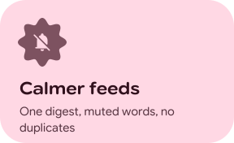</picture>
<picture><source media="(prefers-color-scheme: dark)" srcset=".github/assets/readme/card-stats-dark.svg">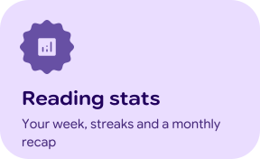</picture>
<picture><source media="(prefers-color-scheme: dark)" srcset=".github/assets/readme/card-backup-dark.svg">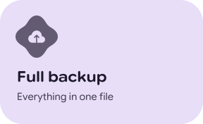</picture>

Brief You is a fork of [Read You](https://github.com/ReadYouApp/ReadYou). It keeps everything that makes Read You great (Material You design, Reeder-style reading, FreshRSS, Miniflux, Fever, Google Reader API and more) and adds AI that runs **entirely on your phone**: articles and questions never leave it. It installs **next to** Read You (app ID `com.ay.briefyou`); move your feeds over with OPML.

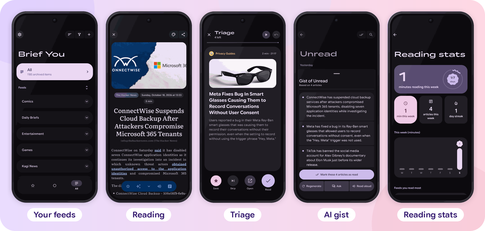

## What's different from Read You

<picture><source media="(prefers-color-scheme: dark)" srcset=".github/assets/readme/h-ai-dark.svg"></picture>

<picture><source media="(prefers-color-scheme: dark)" srcset=".github/assets/readme/t-ai-dark.svg">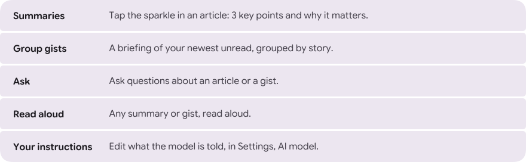</picture>

More details

- Gists cover the newest 40 unread articles in a group, feed or everything.
- Your instructions cover article summaries, gists and Triage card summaries.
- Runs Google's Gemma model through [LiteRT-LM](https://github.com/google-ai-edge/LiteRT-LM). Nothing is sent to a server, and summaries are never saved.
- The model loads in the background a moment after you open the app (Google's advice for LiteRT-LM, whose loading can take up to 10 seconds), so AI answers without waiting; it stays loaded while the app is open and unloads 3 minutes after you leave it. It only loads ahead when the phone can afford it: not in battery saver, with battery to spare or charging, and enough free memory; otherwise it loads on first use. If your phone's GPU can't run it (Pixels' Tensor chips can't), the app remembers and goes straight to the CPU, trying the GPU again after a month.
- Summaries open in a sheet at 70% of the screen. Each key point slides in as a card as it's written, and "Why it matters" gets its own accent card.
- Regenerate, Ask and Read are three connected buttons at the bottom of the sheet.
- Gists: tap **AI gist** in the floating button at the bottom of an *Unread* list. One tap marks all of them as read.
- Ask slides up a box for questions. Answers are short; the model may add general knowledge, and says when it does.

<picture><source media="(prefers-color-scheme: dark)" srcset=".github/assets/readme/h-reading-dark.svg"></picture>

<picture><source media="(prefers-color-scheme: dark)" srcset=".github/assets/readme/t-reading-dark.svg"></picture>

More details

- Toolbar long presses: Star marks read or unread, AI opens its settings, Next goes to the previous article, Full content opens the browser.
- Pictures in the text get a box of their own size with the app's shape-changing loading indicator, and fade in.
- Read later: share a link to *Read Later* (or to *Add Feed* to subscribe to its feed). The page is saved with its full text as a starred article in a *Saved Articles* feed; a small sheet confirms it and closes by itself. If the page can't be loaded (offline, blocked, or a file like a PDF), the link is saved instead. Local accounts only.
- Tidier articles also drop "appeared first on" lines.
- Large header picture; feed, date and reading time as chips; title, time left and a wavy progress bar in the top bar once you scroll.
- Pictures: drag one away to close it; Save and Share in its menu; slightly dimmed in dark mode.
- Selected text and its handles use your accent colour.
- Feeds that only send a teaser show no reading-time estimate rather than a wrong one.
- Articles without a colourful picture keep your theme's colours.

<picture><source media="(prefers-color-scheme: dark)" srcset=".github/assets/readme/h-listen-dark.svg"></picture>

<picture><source media="(prefers-color-scheme: dark)" srcset=".github/assets/readme/t-listen-dark.svg">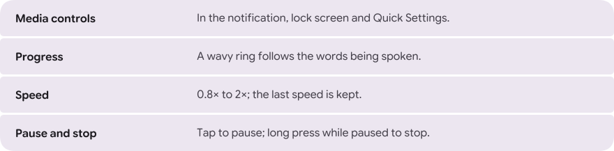</picture>

More details

- The notification shows the title, play/pause, Stop, speed and a progress bar you can drag.
- Long press: speech settings before reading, the speed slider while reading, stop while paused.
- Closing the article (or the AI sheet, for a summary) stops it; leaving the app keeps it going.
- Each read aloud button controls only its own reading: the article's or the summary's.

<picture><source media="(prefers-color-scheme: dark)" srcset=".github/assets/readme/h-triage-dark.svg"></picture>

<picture><source media="(prefers-color-scheme: dark)" srcset=".github/assets/readme/t-triage-dark.svg"></picture>

More details

- Open it with **Triage** in the floating button at the bottom of an *Unread* list. Undo takes back your last choice.
- Summary: the card sinks a little and its border glows in Google's AI colours while the 3 key points are written. Tap the card to switch between the summary and the article's description.
- The run bar has one piece per group, sized by its cards and filled as far as you got. When a group is done you see a ring with how much of your unread is cleared ("3 of 4 groups clear"), what's left and the next group, which starts by itself after a countdown while auto-advance is on.
- *All caught up* only when nothing is unread anywhere, including cards you skipped or left behind, with the run's read, saved and skipped totals (skipped = swiped down; cards left behind by jumping aren't skipped).
- The groups sheet lists every group in the run: jump to any of them, or skip this one. Cards you leave stay unread.
- Top right, Auto-advance and Undo share one joined pill, like the other screens; while auto-advance runs it becomes a circle with its countdown ring.
- The shared picture is drawn just for sharing: the feed and date, the picture, title and a few lines (or the summary's points), the site and the Brief You icon, on a soft backdrop in your colours.
- The four buttons at the bottom and the Next up card squeeze when pressed and spring back.
- Auto-advance pauses while you hold a card, while a card shows its summary and while the groups sheet is open: the button turns grey and its ring stops where it was, then carries on. Long press the button (in the pill or as the circle) to choose the delay (3–30 s, 5 by default).
- Haptics mark the swipe threshold, each choice, Undo and finishing the stack.
- Undo on the first card of a group goes back into the group before it and takes back its last card.
- When a group is done, its bar shrinks into its piece of the run while the other groups' pieces fade in; starting the next group, its piece grows back into the bar.
- The long-press glow only starts once your finger has stayed still for a moment, so swiping never shows it.
- When no untouched group is left but you left cards in one (jumped away, or skipped some), the end screen offers *Back to* that group with how many are left; it never starts by itself.
- Big groups are loaded in full: as a group starts (and near its end) Triage adds any unread cards the stack doesn't have yet.
- Next groups follow your Feeds order. The back gesture turns Triage into a card that follows your finger and is tossed aside.
- Inbox zero also plays when you swipe up to mark everything read on the Unread list.

<picture><source media="(prefers-color-scheme: dark)" srcset=".github/assets/readme/h-calm-dark.svg"></picture>

<picture><source media="(prefers-color-scheme: dark)" srcset=".github/assets/readme/t-calm-dark.svg">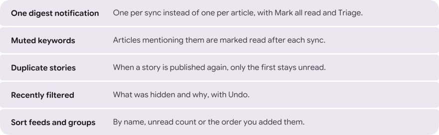</picture>

More details

- Watched words, the opposite of muted keywords (on the Filters page): an unread article with one in its title gets a small chip with the word in lists and on its Triage card, comes first in Triage and in the digest ("2 about Pixel, Gemma"), and is counted on its feed and group at home. A watched article is never muted. Tap a watched word to stop watching it. The Filters page has two tabs you can tap or swipe, *Watched* on the left and *Muted* (with Hide duplicate stories) on the right, under tiles counting what was watched, muted and merged. Adding a word checks the last 3 days straight away ("hid 3", "2 found"). Each tab has its words, Apply now and a recent list laid out the same way: today in full, earlier days grouped by word. Recently watched keeps 30 days.
- The digest reads like "12 new articles · Variety, Kotaku, Kagi News +2".
- Duplicates: another feed, or the same feed twice. Filters lists the hidden copies under the story they repeat, and which copy was kept unread.
- Recently filtered shows today in full; earlier days are grouped by reason (*Duplicate stories*, then each muted keyword) with a count, and open to show 5 articles at a time.
- The digest lists one line per feed, so busy feeds never push the others out. Android shows at most 6 lines, so with more than 6 feeds it shows 5 and a line naming the rest ("+3 more: XKCD, Reddit Comics, Wikipedia").
- A copy is a very similar title from another feed within 48 hours, so repeating headlines like weekly roundups aren't caught.
- Undone articles aren't filtered again; *Reset undone articles* lets the filters catch them.
- The sort is used everywhere: Triage's next group, OPML exports and the backup.
- Filters live in *Settings → Filters*.

<picture><source media="(prefers-color-scheme: dark)" srcset=".github/assets/readme/h-look-dark.svg"></picture>

<picture><source media="(prefers-color-scheme: dark)" srcset=".github/assets/readme/t-look-dark.svg"></picture>

More details

- Expressive loading and pull-to-refresh. Back buttons and Triage's close button are the same tonal circle. In Feeds and Settings, the big title moves into the top bar as you scroll.
- Reading fonts: Google Sans Flex, Literata, system, or your own.
- A pale or grey feed icon gets a steady colour of its own. Icons are cached and loaded at the size they're shown; a site without an icon is searched again once a week.
- Reading stats are in *Settings → Reading stats*: this week Monday to Sunday (a bar per day), articles read, your streak, top feeds, and this month compared with last.
- Monthly recap: for the first week of a month it sits at the top of Reading stats with the articles you read (and the change from the month before), a row of daily bars and four highlights. Tap it and the bars slide into a calendar (tap a day for its numbers) with every highlight: busiest day, top feed, longest streak, reading time, Triage and what the filters hid. Share it as a picture of the card as it is, or hide it with ✕. A slim version shows above your feeds on home (off with *Monthly recap on home*), and *Past months* keeps about a year of recaps.
- Predictive back uses a gentler dim on the screen behind, so it never flashes dark.
- Wide headings use Google Sans Flex at its widest; long names shrink or wrap to fit.
- AMOLED black still works on top of any colours.
- Custom feed icons survive syncs and are saved in OPML exports (with additional info) and the backup.
- The splash takes about 1.3 s, only on fresh launches, and is skipped when animations are off.
- A baseline profile makes the app smooth from the first run after each update.

<picture><source media="(prefers-color-scheme: dark)" srcset=".github/assets/readme/h-backup-dark.svg"></picture>

<picture><source media="(prefers-color-scheme: dark)" srcset=".github/assets/readme/t-backup-dark.svg">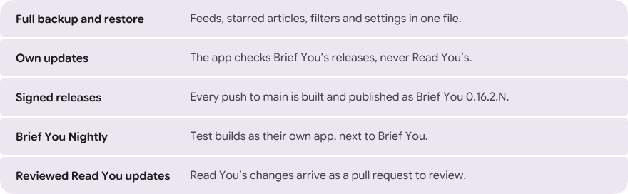</picture>

More details

- The backup also has sync settings and AI instructions.
- Every other branch is built as **Brief You Nightly**, with a night-sky icon, published as the one *Nightly* prerelease.
- Back up in *Account → Advanced → Back up everything*. It also includes custom feed icons, feed and group order, the Triage delay and the read-aloud speed.
- Restore adds everything back on any phone: feeds you already have are kept, feeds go into your existing groups, and starred articles come back even if their feed dropped them. Server logins and the AI model aren't included.
- Release names are Read You's version plus a rising build number, so each APK installs as an update (works with Obtainium). The notes say which Read You version a build is based on.
- APKs are for 64-bit ARM phones (arm64-v8a).
- Builds are signed with Brief You's own key when the repository has the `KEYSTORE_BASE64`, `KEYSTORE_PASSWORD` and `KEY_ALIAS` secrets.
- Read You updates: a daily workflow merges Read You's new commits into a `read-you-sync` branch and opens (or updates) a pull request called *Read You update*. Nothing is built or signed until you merge it. For the pull request to open by itself, allow it in *Settings → Actions → General → Allow GitHub Actions to create and approve pull requests*.
- Brief You Nightly (app ID `com.ay.briefyou.nightly`) has its own data and its own build numbers, so test builds never use up release numbers. Each test build replaces the *Nightly* prerelease, and it doesn't offer Brief You's releases as updates.
- To tidy up, run **Actions → Clean up old releases, tags and runs** by hand. It keeps only the latest of everything: the newest release (and the Nightly), the newest run of each workflow, the kept releases' tags, and branches with work not yet in main (merged branches are deleted). It starts as a dry run that only lists what it would delete.

## Setting up the AI

1. Open **Settings → AI model** and tap **Download Gemma 4 E2B**. On Hugging Face, download `gemma-4-E2B-it.litertlm` (about 2.6 GB).
2. Back in the app, tap **Import model file** and pick it. It's copied into the app; you can delete the download afterwards.
3. Tap ✨ on any article. The first answer takes a few seconds while the model loads.

## How Brief You is organised

Brief You is kept apart from Read You so Read You's updates merge easily:

- **Brief You's own code** lives in `app/src/main/java/me/ash/reader/brief/` (and its own resources, such as `strings_fork.xml`). Read You never touches these files, so they never conflict.
- **Read You's files** are changed only with small hooks, each marked `Brief You`, so a conflict always shows whose line is whose.
- **Rewritten Read You files** (the reading toolbar, top bar, filter bar, web view, read aloud…) have Brief You's own copy instead; Read You's original stays untouched. They're listed in `.github/fork/copies.txt`, and each *Read You update* pull request lists the ones Read You changed, to copy over by hand.
- `.github/fork/fork_check.py` checks this: every build warns about unmarked changes to Read You's files, and each update pull request includes a merge-risk report.

## Building

Open the project in [Android Studio](https://developer.android.com/studio) and run it, or build from the command line with `./gradlew assembleGithubRelease` (Brief You Nightly: `./gradlew assembleGithubNightly`).

## Credits and license

Brief You is built on [**Read You**](https://github.com/ReadYouApp/ReadYou) by [Ashinch](https://github.com/Ashinch) and its contributors. All credit for the original app goes to them, and Brief You picks up its updates. If you like the app, consider [supporting Read You](https://ash7.io/sponsor).

Free software under the [**GNU GPL 3.0**](LICENSE). Gemma is provided under Google's Gemma terms; Brief You doesn't include the model, you download it yourself. The README's pictures use [Material Symbols](https://github.com/google/material-design-icons) (Apache 2.0) and Google Sans Flex.
